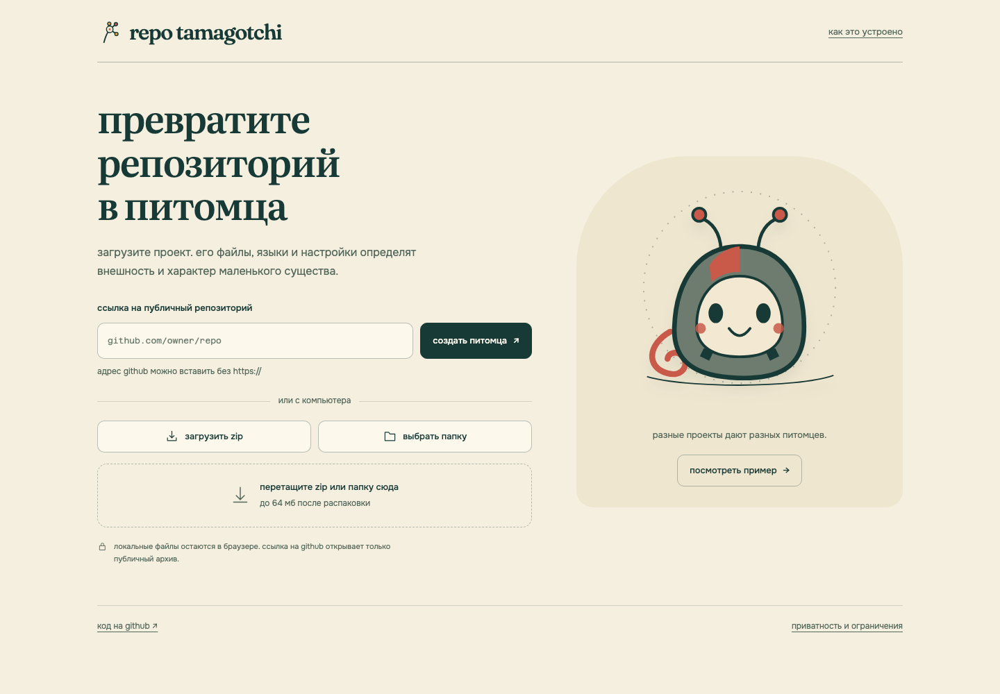
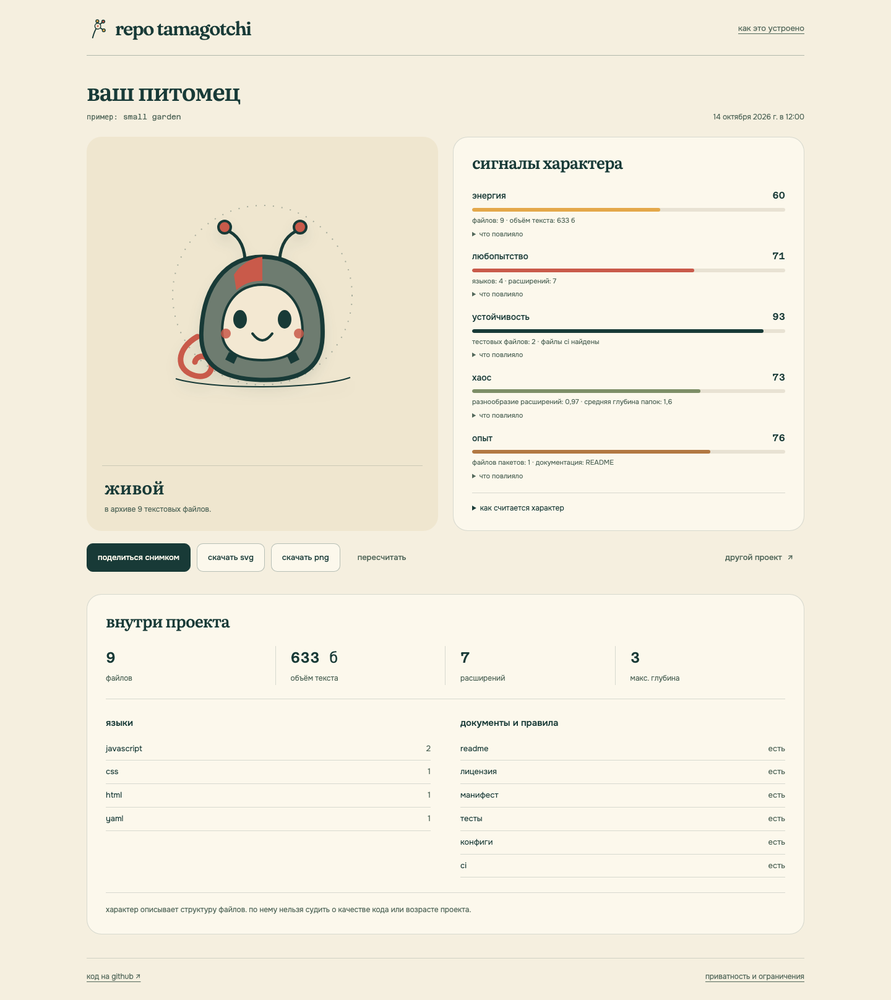
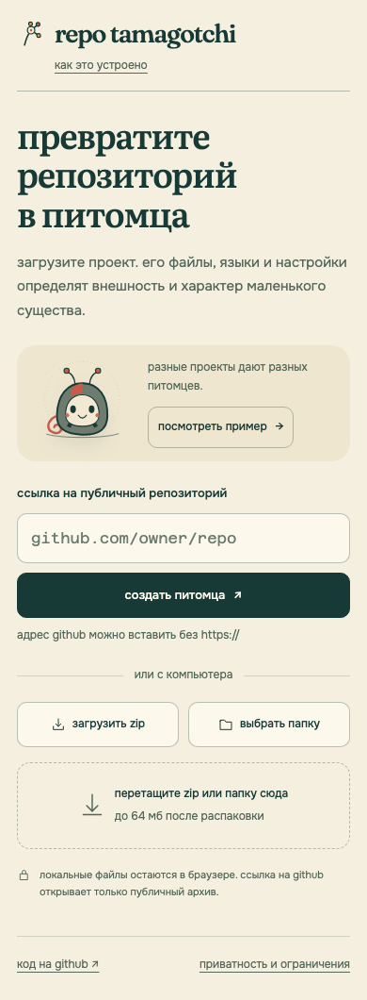

# repo tamagotchi

загрузите репозиторий и познакомьтесь с его питомцем. файлы, языки и настройки определяют внешность и пять характеристик: энергию, любопытство, устойчивость, хаос и опыт.

**[открыть приложение](https://chebaturkin.github.io/repo-tamagotchi/)** · [как запустить локально](#локальный-запуск)



можно вставить публичную ссылку на github, выбрать zip или папку. чтобы сначала посмотреть на результат, нажмите «посмотреть пример»: небольшой учебный проект уже внутри приложения.

рядом с каждой характеристикой можно раскрыть файлы и признаки, которые повлияли на число. кнопки под питомцем позволяют поделиться снимком, скачать svg или png, пересчитать результат и выбрать другой проект.

<details>
<summary>результат анализа и мобильный экран</summary>



<p></p>

</details>

## локальный запуск

```bash
python3 -m http.server 4173
```

откройте [локальный сайт](http://localhost:4173). сборка, установка пакетов и backend не нужны. шрифты и пример лежат в проекте, внешних библиотек у приложения нет.

## источники

- **ссылка на github:** адрес вида `github.com/owner/repo`, с протоколом или без. приложение запрашивает публичный архив `codeload.github.com/owner/repo/zip/HEAD` без токена. если запрос не проходит из-за cors, лимита, таймаута или закрытого репозитория, можно загрузить zip;
- **zip:** выберите архив кнопкой или перетащите на поле. поддерживаются обычные stored/deflate-записи, не больше 10 000 записей и 64 мб после распаковки;
- **папка:** выберите папку целиком или перетащите её на поле. файлы читаются прямо в браузере.

из анализа убираются `.git`, `node_modules`, сборочные каталоги и бинарные файлы. общий корень архива нормализуется: публичная ссылка и скачанный zip дают одинаковый результат.

## как считается характер

это игрушка для наблюдения за структурой проекта. числа описывают файлы, языки, документацию и настройки; по ним нельзя судить о качестве кода, возрасте проекта или его авторе.

у каждой характеристики шкала от 0 до 100. сначала считаются сигналы текстовых файлов, затем применяется формула:

```text
score = clamp(round(35 + 65 × Σ(weight × signal)), 0, 100)
```

нормализация использует фиксированные ориентиры: 500 файлов, 5 мб текста, 12 расширений, 6 языков и 6 уровней глубины. одинаковые файлы всегда дают одинаковый результат.

| характеристика | что на неё влияет |
| --- | --- |
| энергия | количество файлов, объём текста, исходники и скрипты |
| любопытство | языки, расширения, документация, примеры и notebooks |
| устойчивость | тесты, ci, конфиги и lock-файлы |
| хаос | разнообразие расширений, глубина путей, файлы в корне и неизвестные расширения |
| опыт | манифесты, документация, лицензия, тесты, ci и конфиги |

высокий хаос означает разнородную структуру. опыт отражает оформление проекта, а не его возраст. точные веса и правила находятся в [анализаторе](src/analyzer.js).

## снимок и экспорт

«поделиться снимком» копирует ссылку с компактным json-снимком версии 2 в hash-части адреса. ссылка восстанавливает питомца, характеристики и найденные признаки без исходного архива. содержимое файлов в неё не попадает.

питомца можно скачать как svg или png. при открытии чужого снимка пересчёт отключён, потому что исходных файлов нет; кнопка «другой проект» возвращает к загрузке.

## приватность и ограничения

локальные zip и папки никуда не загружаются. внешний запрос выполняется только для введённой публичной ссылки на github. приложение работает без api-ключей, авторизации, базы данных и внешней ai-модели.

повреждённые, зашифрованные, многотомные и неподдерживаемые zip-записи получают сообщение с предложением выбрать другой источник. количество записей и объём распаковки ограничены.

## проверка

после локального запуска откройте тестовые страницы. результат каждой проверки виден в браузере:

- `src/analyzer.test.html`: чтение архивов и анализ;
- `src/analyzer.logic.test.html`: классификация файлов и детерминированность;
- `src/share.test.html`: формат снимка и повреждённые ссылки;
- `src/operation.test.html`: управление асинхронными операциями;
- `src/ui.test.html`: адаптивная вёрстка на семи ширинах, пример, фокус, обратная связь, восстановление снимка и перетаскивание zip.

## публикация

сайт публикуется из корня репозитория через `.github/workflows/pages.yml`. workflow запускается после push в `main` или вручную из вкладки actions.

## шрифты

локальные шрифты лежат в `assets/fonts`. лицензии сохранены рядом:

- fraunces: `assets/fonts/fraunces-OFL.txt`;
- literata: `assets/fonts/literata-OFL.txt`;
- onest: `assets/fonts/onest-OFL.txt`;
- azeret mono: `assets/fonts/azeretmono-OFL.txt`.
