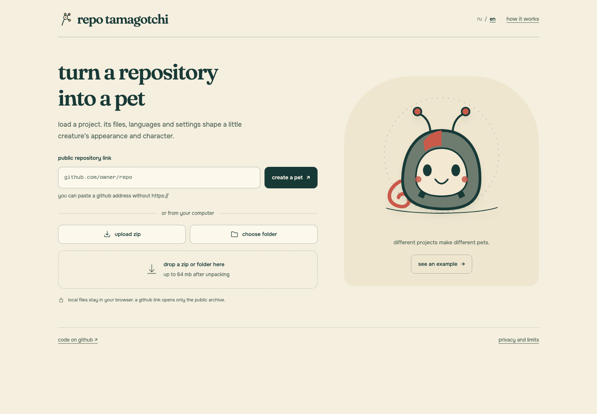
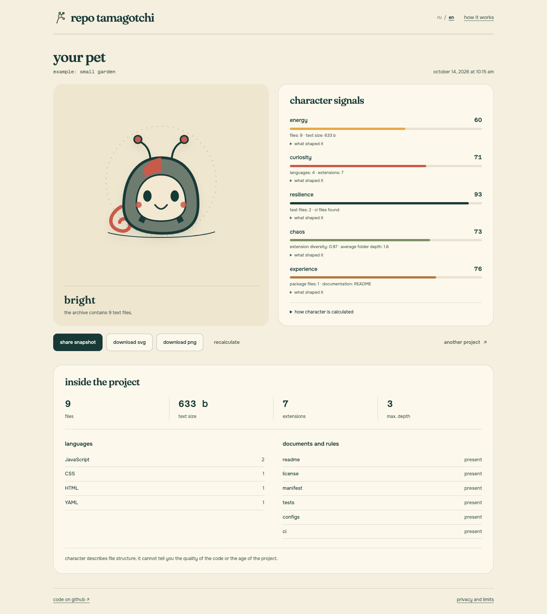
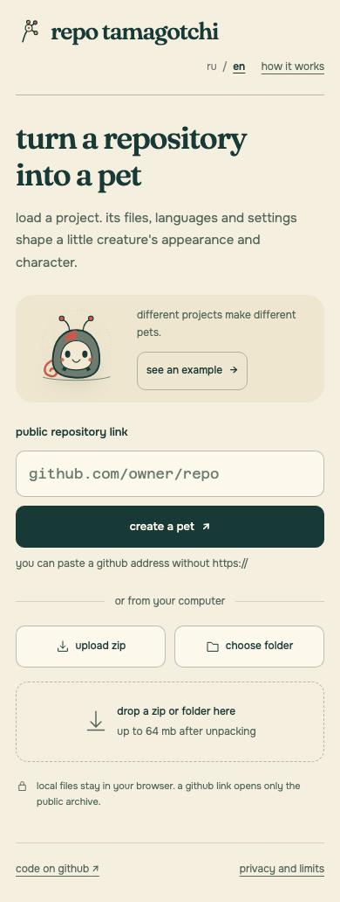

**english** · [русский](README.ru.md)

# repo tamagotchi

load a repository and meet its pet. files, languages and settings shape its appearance and five traits: energy, curiosity, resilience, chaos and experience.

**[open the app](https://chebaturkin.github.io/repo-tamagotchi/?lang=en)** · [run locally](#run-locally) · [русская версия](https://chebaturkin.github.io/repo-tamagotchi/?lang=ru)



paste a public github link, choose a zip or select a folder. “see an example” runs a small fictional project through the same analyzer.

expand each trait to see the files and signals behind its score. the controls below the pet share a snapshot, download svg or png, recalculate, or choose another project.

the compact **ru / en** control changes the interface in place and keeps your source and result. a valid `?lang=en` or `?lang=ru` link takes priority over the saved choice, the first supported browser language and english. repository names, filenames and language identifiers retain their original spelling.

<details>
<summary>analysis result and mobile screen</summary>


<p></p>

</details>

## run locally

```bash
python3 -m http.server 4173
```

open the [local site in english](http://127.0.0.1:4173/?lang=en). no build, packages or backend are needed. fonts and the example are included; the application has no external libraries. use a local server for the browser modules.

## sources

- **github link:** `github.com/owner/repo`, with or without a protocol. the app requests the public `codeload.github.com/owner/repo/zip/HEAD` archive without a token. upload a zip if cors, rate limits, a timeout or a private repository prevent the request.
- **zip:** choose an archive or drop it on the form. ordinary stored/deflate entries are supported, with at most 10,000 entries and 64 mb after unpacking.
- **folder:** choose or drop a complete folder. files are read directly in your browser.

`.git`, `node_modules`, build directories and binary files are excluded. the common archive root is normalized: a public link and its downloaded zip give the same result.

## how character is calculated

a small toy for looking at project structure. the numbers describe files, languages, documentation and settings. they cannot tell you code quality, project age or anything about its author.

each trait has a 0 to 100 scale. text file signals are counted first, then this formula is applied:

```text
score = clamp(round(35 + 65 × Σ(weight × signal)), 0, 100)
```

normalization uses fixed references: 500 files, 5 mb of text, 12 extensions, 6 languages and 6 levels of depth. identical files always give identical scores.

| trait | signals |
| --- | --- |
| energy | file count, text size, source files and scripts |
| curiosity | languages, extensions, documentation, examples and notebooks |
| resilience | tests, ci, configs and lockfiles |
| chaos | extension diversity, path depth, root files and unknown extensions |
| experience | manifests, documentation, license, tests, ci and configs |

high chaos means a varied structure. experience reflects project setup, not age. exact weights and rules are in the [analyzer](src/analyzer.js).

## snapshots and exports

“share snapshot” copies a link with a compact version 2 json snapshot in its hash. the link restores the pet, traits and evidence without the original archive. file contents are not included.

download the pet as svg or png. recalculation is disabled for a shared snapshot because its source files are absent. “another project” returns to the source form. switching languages preserves the snapshot hash.

## privacy and limits

local zips and folders are never uploaded. the only external request is for the public github link you enter. there are no api keys, accounts, database or external ai model.

damaged, encrypted, multipart and unsupported zip entries produce an error with a way to choose another source. entry count and unpacked size are bounded. the saved language preference is optional; blocked browser storage does not prevent using the app.

## checks

after starting the local server, open the test pages. results appear in the browser:

- `src/analyzer.test.html`: archive reading and analysis.
- `src/analyzer.logic.test.html`: file classification and deterministic results.
- `src/share.test.html`: snapshot format and damaged links.
- `src/operation.test.html`: asynchronous operation management.
- `src/ui.test.html`: responsive layout at seven widths, example, focus, feedback, snapshot restoration and zip drop.

the locale unit check needs node.js. browser checks and screenshot capture also need playwright and chromium. install these optional tools in the repository root:

```bash
npm install --no-save --package-lock=false playwright
npx playwright install chromium
```

keep the local server running, then check both languages and state preservation:

```bash
node --test tests/i18n.test.cjs
REPO_TAMAGOTCHI_URL=http://127.0.0.1:4173 node tests/i18n-browser.cjs
REPO_TAMAGOTCHI_URL=http://127.0.0.1:4173 node tests/state-preservation.cjs
```

update both language screenshot sets with:

```bash
REPO_TAMAGOTCHI_URL=http://127.0.0.1:4173 node tests/capture-screenshots.cjs
```

## publication

the repository root is published through `.github/workflows/pages.yml`. the workflow runs after a push to `main` or a manual run from actions.

## fonts

local fonts and their licenses are in `assets/fonts`:

- fraunces: `assets/fonts/fraunces-OFL.txt`.
- literata: `assets/fonts/literata-OFL.txt`.
- onest: `assets/fonts/onest-OFL.txt`.
- azeret mono: `assets/fonts/azeretmono-OFL.txt`.
